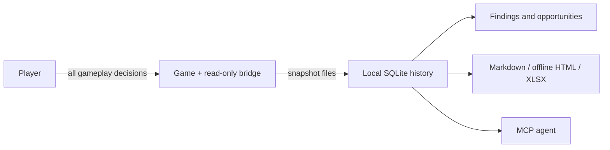

# TF3 Companion

**Understand your transport company without handing over the controls.** TF3 Companion is an unofficial, local-first, read-only analyst for Transport Fever 3. A small bridge mod exports snapshots; the companion keeps history, explains findings, generates reports and spreadsheets, and exposes the same data to MCP-capable agents. You decide and make every change in the game.

Not affiliated with or endorsed by Urban Games or Paradox Interactive. Product names are used descriptively; no trademark clearance is claimed. Created by Alexandre Lima. [MIT license](LICENSE).

## How it works



Collection and analysis require no hosted service or telemetry. Installing dependencies and connecting an AI client may use the network; the client can send requested game data to its provider. See [privacy](docs/privacy.md).

## Install with an AI assistant

Prefer guided setup? Paste the request in [Install with an AI assistant](docs/agent-assisted-installation.md) into a local agent with terminal access, or into a browser chat that will give you commands to run. The assistant follows the [setup guide](src/tf3companion/setup_guide.md), asks before every change to your computer and reports each stage (package, game paths, bridge, activation, MCP, fresh snapshot, first report) as verified, pending or failing. You still enable the mod and play the game yourself.

## Install from source

The package is **not published on PyPI yet**. Download or clone this repository using its actual GitHub location, then open a terminal in the checkout. Install [uv](https://docs.astral.sh/uv/); uv can provision the required Python 3.12+ interpreter.

### Windows PowerShell

```powershell
Set-Location C:\Projects\tf3-companion
uv sync --locked
uv run tf3c doctor
# Set this only if discovery fails or finds more than one game account:
$env:TF3C_USERDATA_DIR = 'C:\Program Files (x86)\Steam\userdata\ACCOUNT_ID\3493540\local'
uv run tf3c mod install
```

### macOS

```sh
cd /path/to/tf3-companion
uv sync --locked
uv run tf3c doctor
# Set this only if discovery fails or finds more than one game account:
export TF3C_USERDATA_DIR="$HOME/Library/Application Support/Steam/userdata/ACCOUNT_ID/3493540/local"
uv run tf3c mod install
```

Replace example checkout paths and `ACCOUNT_ID` with your own values. The userdata override must point to the game's `local` directory, not its executable or Steam library. Review the install output before proceeding. See [mod installation](docs/install-mod.md) for manual installation, updates and removal.

### Collect your first snapshot

1. Open the game and enable **TF3 Companion Bridge** for the intended save.
2. Reload that save and save it. An installed folder alone does not activate a mod.
3. Keep the save loaded, then run:

```sh
uv run tf3c refresh --timeout 30
uv run tf3c status
uv run tf3c findings
```

If the game has already exported snapshots, `uv run tf3c ingest` imports them without a refresh request. A timeout is not evidence of an empty company: check [troubleshooting](docs/troubleshooting.md).

## Explore and discuss

```sh
uv run tf3c overview
uv run tf3c lines
uv run tf3c line "Example line"
uv run tf3c findings --json
uv run tf3c opportunities
uv run tf3c notes --append "Review freight lines before expanding the fleet."
uv run tf3c notes
uv run tf3c export --open
uv run tf3c log
```

### Judge the company by your own rules

A methodology is one shareable JSON file that classifies your lines, sets tolerances, adds recommendations and picks the reports. The neutral `default` reproduces the built-in findings; the packaged `local-feeder-intercity-trunk` is the author's own policy as an example. See [methodologies](docs/methodologies.md).

```sh
uv run tf3c methodology list
uv run tf3c methodology validate src/tf3companion/methodology/examples/local-feeder-intercity-trunk.tf3c-methodology.json --strict
uv run tf3c methodology use local-feeder-intercity-trunk
uv run tf3c analyse
uv run tf3c analyse --methodology default
```

`analyse` writes its reports to `reports/<game-date>__<methodology-id>@<version>/` under the companion data directory.

Reports and their coverage limits are described in [reports](docs/reports.md). To connect an agent, use an **absolute checkout path**:

```sh
uv run --project /absolute/path/to/tf3-companion tf3c mcp
```

See [agent setup](docs/agents.md) for Windows/macOS configuration examples. The server communicates over stdio, not a hosted endpoint.

### Read the numbers carefully

- Vehicle `load` is an instantaneous observation, not average utilization or proof that more vehicles are needed.
- `profitYear` is a rolling game-year measure; it must not be summed into calendar-year income.
- The meaning of `transportedYear` is not yet verified for annual accounting.
- Collector errors, missing snapshots and partial years limit conclusions.
- The current store is not proven isolated per save. Do not mix unrelated saves in one companion data directory.

## Compatibility and release status

This is a source-development build, not a published release. Compatibility evidence is narrower than the intended platform support.

| Area | Evidence / status |
| --- | --- |
| macOS game bridge | The existing OpenSpec notes record prototype snapshot output on game build 40420; the updated release still needs an in-game rehearsal. |
| Windows | Portable source setup and discovery are implemented; a real Windows game installation, activation and refresh are not verified. |
| Linux / Proton | Best-effort candidate discovery; live game compatibility is not verified. |
| GitHub Actions | Windows/macOS/Linux locked tests and package build are configured; no hosted CI run is claimed. |
| Save identity | Persistent lineage and end-to-end isolation remain release gates. |

No screenshots, logos, badges or published package links are presented as available before they exist. The [roadmap](docs/ROADMAP.md) distinguishes delivered source work, current review and planned release gates; OpenSpec remains the detailed acceptance record.

## Documentation

- [Roadmap](docs/ROADMAP.md) · [Review evidence and open gates](docs/review-notes.md)
- [Install with an AI assistant](docs/agent-assisted-installation.md) · [Setup guide](src/tf3companion/setup_guide.md)
- [Install the mod](docs/install-mod.md) · [Connect an agent](docs/agents.md)
- [Reports](docs/reports.md) · [Privacy and storage](docs/privacy.md) · [Troubleshooting](docs/troubleshooting.md)
- [Contribute](CONTRIBUTING.md) · [Contributor/agent guide](AGENTS.md)
