<div align="center">

<picture>
  <source media="(prefers-color-scheme: dark)" srcset="assets/brand/logo-mark.svg">
  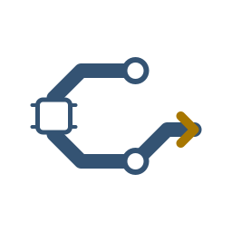
</picture>

# TF3 Companion

**Ask your company anything - lines, loads and losses.**

An unofficial, local-first, **read-only** analyst for [Transport Fever 3](https://store.steampowered.com/app/3493540/). A small bridge mod exports your company; the companion keeps its history, explains what is going wrong, and lets an AI agent of your choice answer questions about it. **You decide and make every change in the game.**

[](https://github.com/alexandrevl/tf3-companion/actions/workflows/ci.yml)
&nbsp;MIT licence · Python 3.12+ · Windows, macOS, Linux · MCP stdio server

[Quick start](#quick-start) · [How it works](#how-it-works) · [See it in action](#see-it-in-action) · [What you can ask](#what-you-can-ask) · [Methodologies](#judge-the-company-by-your-own-rules) · [Docs](#documentation)

</div>

> Not affiliated with or endorsed by Urban Games or Paradox Interactive. Transport Fever is their trademark and is named only descriptively. Created by Alexandre Lima.

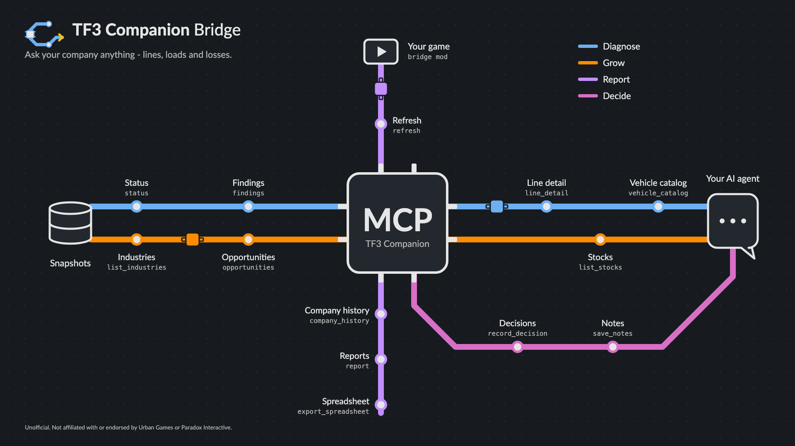

The map above is the product. Your game and its snapshot database sit on the left and top, your AI agent on the right, and the companion's MCP server is the chip in the middle. The four coloured lines are the four things you do with it: **Diagnose** what is losing money, find where to **Grow**, **Report** how the company evolves, and **Decide** with a journal of what you agreed.

## Why

- A big company hides its problems. A line can lose money for a year before you notice, a coal mine can overflow because nothing serves it, and a fleet can be far too large or too small for its load.
- The numbers are in the game, but scattered across windows. The companion collects them over time, so you can see **trends, not just the current instant**.
- It tells you what the evidence supports and what it cannot: a missing value is never treated as zero, and every figure carries its date and its limits.
- It never plays for you. There is no code path that buys a vehicle, builds a track or changes the simulation.

## How it works

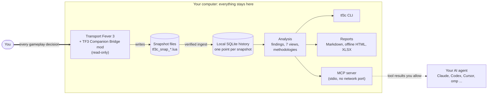

A conversation with your agent goes like this:

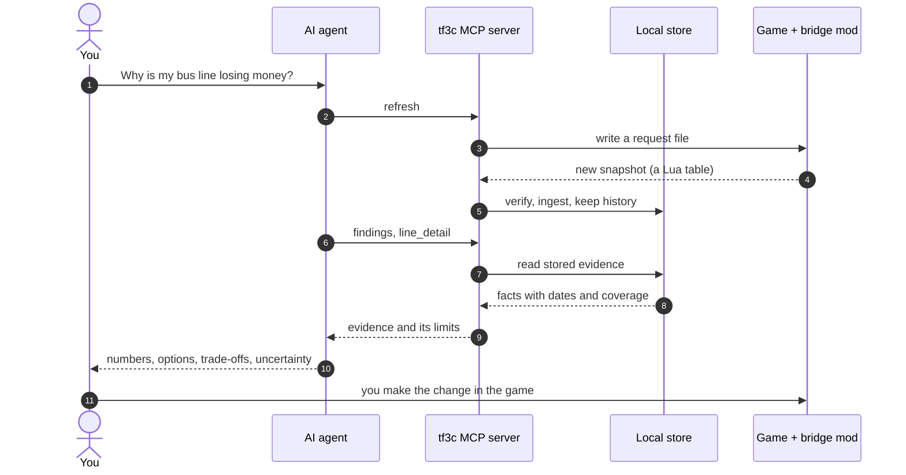

Collection and analysis need no hosted service and send no telemetry. Installing dependencies and connecting an AI client may use the network, and **the client can send what the tools return to its provider**. See [privacy](docs/privacy.md).

## See it in action

Everything below was produced by the real `tf3c` commands over **synthetic** data (invented lines named Heron and Maple Express, 37 monthly snapshots). It shows what the output looks like, not a real company.

`tf3c findings`:

```text
Methodology: default@1.0.0 (sha256:2f2bcb30965a)
!! [lines] Heron: loss over the last year
     Annual result -20,000. Current load: 10%.
     → Check whether demand justifies the fleet: reduce vehicles, review the stops or change transport mode. If the line feeds another line (network), assess the whole before cutting.
!! [lines] Maple Express: loss over the last year
     Annual result -150,000. Current load: 95%.
     → Check whether demand justifies the fleet: reduce vehicles, review the stops or change transport mode. If the line feeds another line (network), assess the whole before cutting.
!  [industries] Redfall Pit: stock full
     400 of 400 units at this sample.
     → Inspect shipment connections and queues; fullness alone does not identify a cause.
!  [lines] Maple Express: overloaded (95%)
     Vehicles are almost full at snapshot time. Load is an instant reading, not an average; this alone does not establish persistent crowding or unmet demand.
     → Compare earlier snapshots and station queues before changing fleet size. If persistent crowding is confirmed, consider more or larger vehicles and check station frequency limits.
```

Notice the two findings for Maple Express: a loss at 95% load is not a "too many vehicles" problem, and the report says so instead of guessing.

`tf3c report company` and `tf3c report history` draw charts that GitHub (and any Mermaid viewer) renders directly:

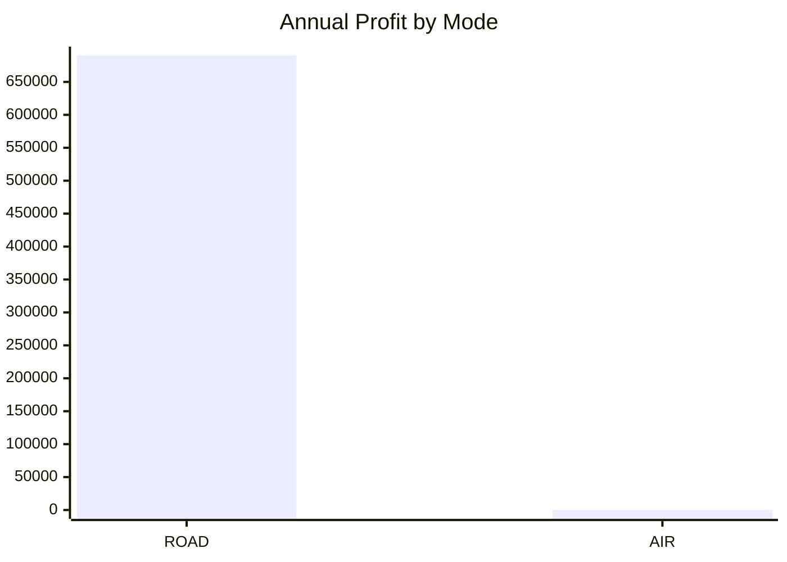

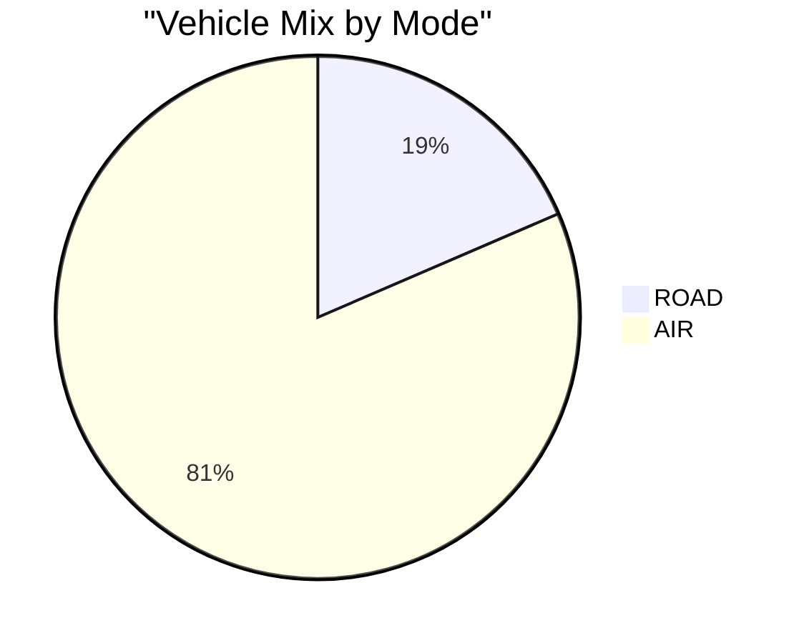

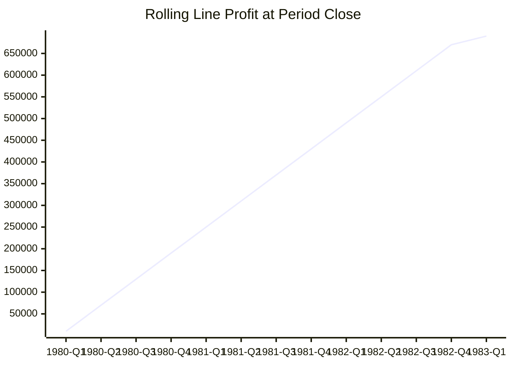

Rolling profit is a level at a date, not income earned in the period, so the report never adds the rows together. Real reports also carry the sampling cadence, coverage gaps and a "what this history can and cannot tell you" section. See [reports](docs/reports.md).

## What you can ask

The MCP server exposes **30 tools**, grouped like the four lines on the map. Your agent picks them; you just ask in plain language.

| Line | You might ask | Tools |
| --- | --- | --- |
| **Diagnose** | Which lines lose money? What is wrong with this one? | `status`, `findings`, `company_overview`, `list_lines`, `line_detail`, `list_vehicles`, `list_depots`, `list_towns`, `vehicle_catalog` |
| **Grow** | Which industry ships nothing? Where could a new line pay off? | `list_industries`, `opportunities`, `list_stocks` |
| **Report** | How did the company evolve? Give me a spreadsheet. | `refresh`, `company_history`, `report`, `export_spreadsheet`, `log_tail`, `doctor` |
| **Decide** | Remember what we agreed and check it later. | `record_decision`, `update_decision`, `list_decisions`, `save_notes` |
| **Judge** | Apply my own rules to the company. | `list_methodologies`, `methodology_detail`, `validate_methodology`, `evaluate`, `analyse`, `set_methodology_default`, `set_save_methodology` |
| **Learn** | How does this game mechanic work? | `knowledge` (7 topics: mechanics, strategy, cargo economy, snapshot schema, methodology fields, engine, API catalogue) |

Eight ready-made conversations are built in as MCP prompts: `setup-check`, `monthly-review`, `annual-review`, `line-triage`, `fleet-renewal`, `cargo-opportunities`, `decision-review` and `apply-methodology`.

<details>
<summary><b>14 report kinds and 7 structured analysis views</b></summary>

| Reports (`tf3c report KIND`) | |
| --- | --- |
| `company`, `lines`, `fleet`, `cargo`, `decisions`, `annual` | The everyday set |
| `history`, `vehicle-roi`, `lines-history`, `industries`, `towns`, `expansion`, `bottlenecks` | Longitudinal analyses built from stored history |
| `methodology` | The verdicts of the effective methodology |

`tf3c evaluate --view NAME` (repeatable) adds a structured, report-independent analysis of stored history under `analysisViews`: `bottlenecks`, `expansion`, `lines-history`, `history`, `industries`, `vehicle-roi`, `towns`. Nothing is computed unless you ask for it.

</details>

## Quick start

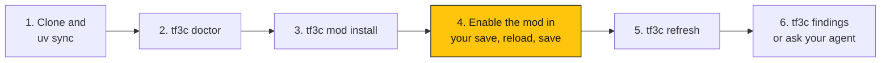

Step 4 is the only part you do inside the game; an installed mod folder alone does not activate it.

**Prefer guided setup?** Paste the request in [Install with an AI assistant](docs/agent-assisted-installation.md) into a local agent with terminal access. It follows the [setup guide](src/tf3companion/setup_guide.md), asks before every change to your computer, and reports each stage (package, game paths, bridge, activation, MCP, fresh snapshot, first report) as verified, pending or failing.

### Install from source

The package is **not published on PyPI yet**. Install [uv](https://docs.astral.sh/uv/) (it can provision Python 3.12+), then:

```sh
git clone https://github.com/alexandrevl/tf3-companion.git
```

<details open>
<summary><b>Windows PowerShell</b></summary>

```powershell
Set-Location C:\Projects\tf3-companion
uv sync --locked
uv run tf3c doctor
# Set this only if discovery fails or finds more than one game account:
$env:TF3C_USERDATA_DIR = 'C:\Program Files (x86)\Steam\userdata\ACCOUNT_ID\3493540\local'
uv run tf3c mod install
```

</details>

<details open>
<summary><b>macOS</b></summary>

```sh
cd /path/to/tf3-companion
uv sync --locked
uv run tf3c doctor
# Set this only if discovery fails or finds more than one game account:
export TF3C_USERDATA_DIR="$HOME/Library/Application Support/Steam/userdata/ACCOUNT_ID/3493540/local"
uv run tf3c mod install
```

</details>

Replace the example checkout paths and `ACCOUNT_ID` with your own values. The userdata override must point to the game's `local` directory, not its executable or Steam library. Review the install output before proceeding. See [mod installation](docs/install-mod.md) for manual installation, updates and removal.

### Collect your first snapshot

1. Open the game and enable **TF3 Companion Bridge** for the intended save.
2. Reload that save and save it.
3. Keep the save loaded, then run:

```sh
uv run tf3c refresh --timeout 30
uv run tf3c status
uv run tf3c findings
```

If the game has already exported snapshots, `uv run tf3c ingest` imports them without a refresh request. A timeout is not evidence of an empty company: check [troubleshooting](docs/troubleshooting.md).

### Explore and discuss

```sh
uv run tf3c overview
uv run tf3c lines
uv run tf3c line "Example line"
uv run tf3c findings --json
uv run tf3c opportunities
uv run tf3c notes --append "Review freight lines before expanding the fleet."
uv run tf3c notes
uv run tf3c export --open
uv run tf3c log
```

### Connect an AI agent

Use an **absolute checkout path**; the server speaks over stdio, not a hosted endpoint:

```sh
uv run --project /absolute/path/to/tf3-companion tf3c mcp
```

See [agent setup](docs/agents.md) for Windows and macOS configuration examples for Claude Code, Claude Desktop, Cursor, Codex and omp. After upgrading the package, restart the server: it does not hot reload.

## Judge the company by your own rules

A **methodology** is one shareable JSON file: it classifies your lines into roles, sets tolerances, adds rules and recommendations, and picks the reports. The neutral `default` reproduces the built-in findings; the packaged `local-feeder-intercity-trunk` is the author's own policy, kept as an example.

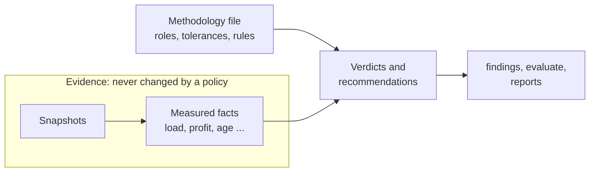

Two people can look at the same facts and reach different verdicts, because the policy is theirs. Which file applies is decided by precedence:

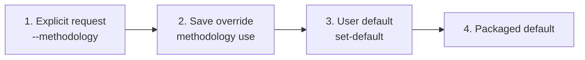

```sh
uv run tf3c methodology list
uv run tf3c methodology validate src/tf3companion/methodology/examples/local-feeder-intercity-trunk.tf3c-methodology.json --strict
uv run tf3c methodology set-default local-feeder-intercity-trunk
uv run tf3c analyse
uv run tf3c analyse --methodology default
```

`analyse` ingests, evaluates and writes its reports to `reports/<game-date>__<methodology-id>@<version>/` under the companion data directory. To get the complete structured conclusion **without ingesting or writing anything**, evaluate the stored evidence:

```sh
uv run tf3c evaluate
uv run tf3c evaluate --methodology default --json
uv run tf3c evaluate --methodology ./my.tf3c-methodology.json --param tolerated_loss=80000 --json
```

`evaluate` never discovers Steam, imports newer exports or creates files; run `tf3c ingest` or `tf3c refresh` first for newer evidence. Importing a file never activates it; import, selection and analysis reject incompatible policy without replacing previous configuration or results. See [methodologies](docs/methodologies.md) for the schema, diagnostics, report policies and calendar-based ages with explicit unknown values.

## Read the numbers carefully

- Vehicle `load` is an instantaneous observation, not average utilisation or proof that more vehicles are needed.
- `profitYear` is a rolling game-year measure; it must not be summed into calendar-year income.
- The meaning of `transportedYear` is not yet verified for annual accounting.
- Collector errors, missing snapshots and partial years limit conclusions.
- The current store is not proven isolated per save. Do not mix unrelated saves in one companion data directory (see [privacy](docs/privacy.md)).

## What it will never do

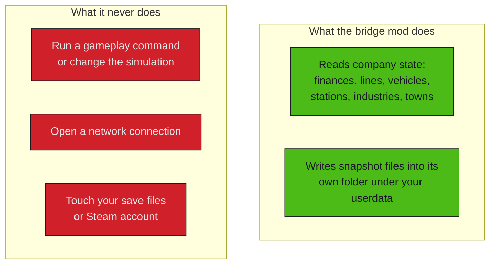

The boundary is enforced in review, not just promised: the repository has no `api.cmd` call, the Python companion makes no outbound connection, and every file in the repository is checked for private data before it can be committed.

## Compatibility and status

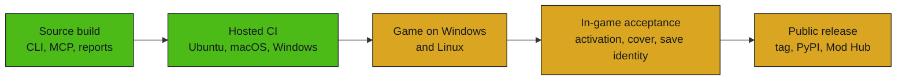

Green is verified; amber is not yet. This is a source-development build, not a published release.

| Area | Evidence / status |
| --- | --- |
| macOS game bridge | The existing OpenSpec notes record prototype snapshot output on game build 40420; the updated release still needs an in-game rehearsal. |
| Windows | Portable source setup and discovery are implemented and the whole test suite passes on a Windows runner; a real Windows game installation, activation and refresh are not verified. |
| Linux / Proton | Best-effort candidate discovery; the tests pass on Linux runners; live game compatibility is not verified. |
| GitHub Actions | Lint, repository guards, pre-commit hooks, OpenSpec validation, dependency review and locked tests on Ubuntu (Python 3.12 and 3.14), macOS and Windows pass on GitHub (Lua 5.4 compiled on every runner), alongside CodeQL and a draft-only release workflow. `main` is protected: pull requests need those checks. A pre-commit hook repeats the fast checks locally. |
| Save identity | Persistent lineage and end-to-end isolation remain release gates. |

No screenshots from the game are shown because none have been approved yet; the example output above is generated from synthetic data and says so. The [roadmap](docs/ROADMAP.md) separates delivered source work, current review and planned release gates; OpenSpec remains the detailed acceptance record.

## Documentation

| Start here | For contributors | Reference |
| --- | --- | --- |
| [Install with an AI assistant](docs/agent-assisted-installation.md) | [Contributing](CONTRIBUTING.md) | [Reports](docs/reports.md) |
| [Setup guide](src/tf3companion/setup_guide.md) | [Architecture](docs/architecture.md) | [Methodologies](docs/methodologies.md) |
| [Install the mod](docs/install-mod.md) | [Contributor and agent guide](AGENTS.md) | [Privacy and storage](docs/privacy.md) |
| [Connect an agent](docs/agents.md) | [Roadmap](docs/ROADMAP.md) · [Review evidence](docs/review-notes.md) | [Publishing the mod](docs/publishing-mod.md) |
| [Troubleshooting](docs/troubleshooting.md) | [Brand identity](docs/brand/identity.md) | [First-push runbook](docs/first-push.md) |

## Security, conduct and third-party material

- Report vulnerabilities privately, following [SECURITY.md](SECURITY.md); do not open a public issue for them.
- Everyone taking part is expected to follow the [code of conduct](CODE_OF_CONDUCT.md).
- The game-knowledge topics adapt facts from the MIT-licensed MPFever research project, paraphrased and cited; see [NOTICE](NOTICE) for the attribution and licence text. No game or third-party source code is included.

Released under the [MIT licence](LICENSE).
