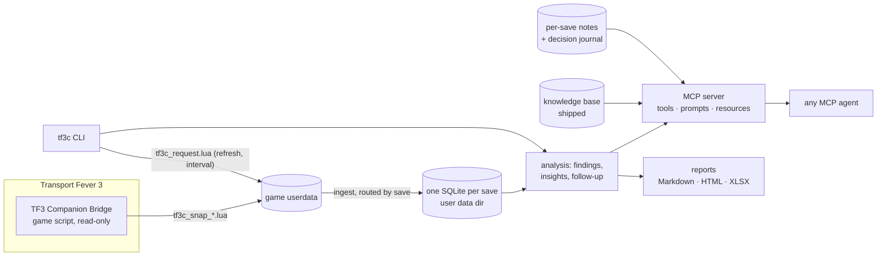

# TF3 Companion — Roadmap to a public release

Status: approved plan, 2026-10-11. Author: Alexandre Lima (`alexandrevl`). Licence: MIT.
Detailed plans live in OpenSpec: `openspec/changes/<change>/` (proposal, specs, design, tasks).
Run `openspec list` to see progress.

## 1. Vision

**TF3 Companion** is an unofficial, read-only data analyst for Transport Fever 3.
A small in-game mod exports periodic snapshots of your company; a local companion
stores the history, runs analyses and serves them to any AI agent over MCP (Claude
Code, Claude Desktop, Cursor, Codex, omp…) or to you directly through a CLI and reports.

You play; the companion watches the numbers, explains the mechanics and remembers
what you decided and whether it worked.

### Principles

| Principle | Consequence |
|---|---|
| Read-only | The mod never issues `api.cmd` commands. Safe to add/remove from any save; marked `cosmetic`. |
| Local-first | No network, no telemetry. Everything lives on the player's disk. |
| Windows and macOS first-class | Discovery, install, paths and opening files work on both; Linux/Proton best effort. |
| Agent-agnostic | MCP is the main interface; CLI and reports work without any AI. |
| Evidence over opinion | Every finding carries the numbers, the snapshot date and a source for any game-mechanic claim. |
| English in code and docs | The agent answers in the player's language; data and docs stay English. |

### Non-goals (v1)

- Acting in the game (buying vehicles, editing lines).
- Reading save files directly (zstd + binary format; reverse engineering).
- A hosted service or a GUI app.

## 2. Names (decided)

| Thing | Name |
|---|---|
| Product | TF3 Companion (README carries an "unofficial, not affiliated with Urban Games / Paradox" disclaimer) |
| Repo / PyPI | `tf3-companion` (import `tf3companion`) |
| CLI | `tf3c` |
| MCP server | `tf3-companion` |
| Mod id / display name | `tf3_companion_bridge` / TF3 Companion Bridge |
| Snapshot files | `<userdata>/towns_industries/tf3c_snap_<gameTime>.lua`, request `tf3c_request.lua` |
| Log prefix | `[tf3c]` |

## 3. Architecture

## 4. Changes (OpenSpec), in implementation order

| # | Change | Delivers |
|---|---|---|
| 1 | `rebrand-tf3-companion` | Rename to `tf3companion`/`tf3c`/`tf3_companion_bridge`; English everywhere; single output sink; data dir outside the repo; knowledge shipped as package data; player notes; finding `code`s; baseline specs; first commit |
| 2 | `cross-platform-and-saves` | Windows/macOS discovery and real-machine acceptance; `doctor`; portable mod installation; verified persistent lineage ids and isolated histories; configurable interval; compression; schema 2 |
| 3 | `analysis-insights` | Cargo config mismatch, full stocks, load trend, fleet fit vs catalog, idle capital, orphan lines, line scope economics, decision follow-up; `transportedYear` investigation; schema 3 (station positions and links) |
| 4 | `basic-reports` | Company, lines, fleet, cargo, decision follow-up and **annual** reports; Markdown (with Mermaid) + offline HTML; XLSX export kept; `tf3c report`, MCP `report` |
| 5 | `agent-experience` | MCP server instructions (analyst persona), prompts (`monthly-review`, `annual-review`, `line-triage`, `fleet-renewal`, `cargo-opportunities`, `decision-review`), resources; contributor `AGENTS.md` |
| 6 | `release-readiness` | README, docs set, LICENSE, CHANGELOG, CONTRIBUTING, CI on Windows/macOS/Linux, Lua harness + luacheck, anonymised fixtures, mod artwork, issue templates, compatibility table, manual publish checklist |

Each change ends with an in-game check by the player when the mod changes, `uv run pytest`, and a local commit.
Publishing (GitHub remote, PyPI, mod.io via the in-game Mod Hub) is a manual checklist at the end of change 6.

## 5. Key design decisions

- **One tested output path.** `app.saveUserdata("towns_industries", …)` worked on build 40420/macOS. Windows still needs real-game verification; do not generalise platform evidence.
- **Save identity must not be guessed from towns.** Independent games can share town ids. Require a bridge-owned lineage id, persistence probes and lineage-scoped filenames before claiming save isolation.
- **Interval through the request file.** This works with existing games without relying on unverified mod-parameter editing support.
- **Size handled by compression**, not by lighter snapshots: benchmark the observed ≈570 KB JSON snapshots; retain existing raw-file pruning only after successful ingestion.
- **Reports as Markdown first.** Conversation plus tables and charts proved more useful than the spreadsheet; HTML for the browser, XLSX as raw data.
- **Persona in the MCP server.** Any agent gets the analyst behaviour from the server instructions; `AGENTS.md` is for contributors.

## 6. What the first sessions taught (input for change 3)

Taken from the March–July 1983 sessions on the author's save:

| Learning | Consequence |
|---|---|
| Trucks were set to the wrong cargo (Planks on a Logs line, Paper on a Bricks line); the player fixed both after we pointed it out | Automatic cargo config mismatch finding |
| The player's hypothesis "the warehouse is full" was right (Logs 500/500); 62 of 108 industries had a full output stock | Full-stock findings, aggregated to avoid noise |
| Every answer needed the caveat "load is an instant reading" | Load trend from history replaces instant load findings |
| "Which vehicle suits this line?" | Fleet fit against the year's catalog |
| 10 ships worth ≈$9.8M sat in depots | Idle-capital finding |
| Profit is a rolling 12-month window, so fixes show slowly | Decision follow-up compares before/after once enough time passed |
| Short local lines earned $22k/vehicle vs $647k on regional ones | Scope economics from stop distances, not from a naming mod |
| The player needs full entity names to find things in game | Rule for every output |
| `transportedYear` looked too low | Investigate before use |

## 7. Platform plan

| Platform | Discovery | Mod install | Validation |
|---|---|---|---|
| macOS | `~/Library/Application Support/Steam/userdata/<id>/3493540/local` (observed) | Planned portable CLI; staging-area installation observed with the prototype script | Real-game release gate |
| Windows | Steam registry/default paths; TF3 userdata layout must be verified on Windows | Same planned command, with explicit path override | Real Windows installation, activation and refresh gate; CI alone is insufficient |
| Linux / Proton | Candidate Steam/Flatpak locations | Same planned command | Best effort; disclose actual verification |

## 8. Delivery gates and planning corrections

- English-only maintained files, comments, messages and mod metadata. Player-provided entity names remain verbatim.
- Annual reports disclose exact observation dates, gaps and partial-year coverage. Rolling `profitYear` values MUST NOT be summed into calendar-year income; a later-year snapshot does not prove the previous year was fully observed.
- Scripts and unit tests do not establish Windows/game compatibility; record actual platform evidence.
- Name availability and trademark clearance are not established by the exploratory search. Do not claim either.
- License: MIT; credit Alexandre Lima. No remote, URL, package publication or mod upload is created in this local-development stage.
- First commit excludes databases, snapshots and player notes. Preserve local backups and the installed prototype until the player-controlled reload.
