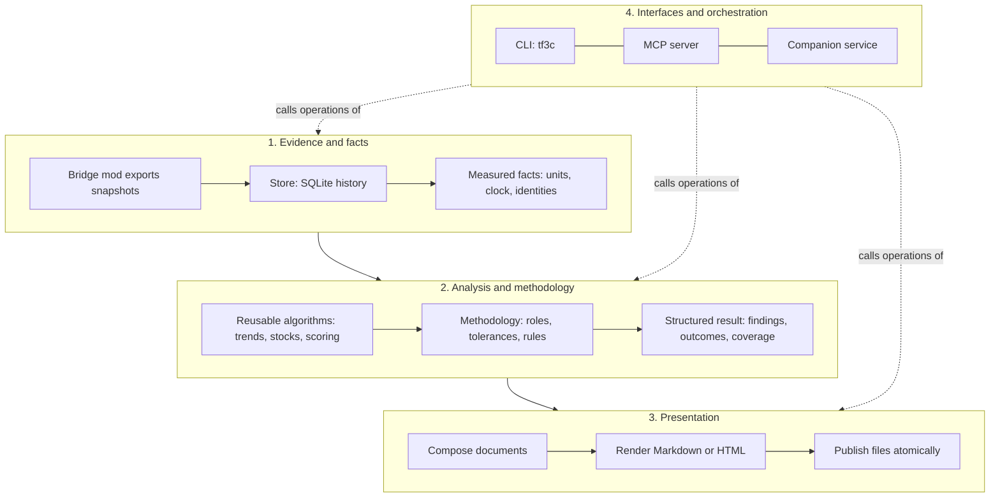
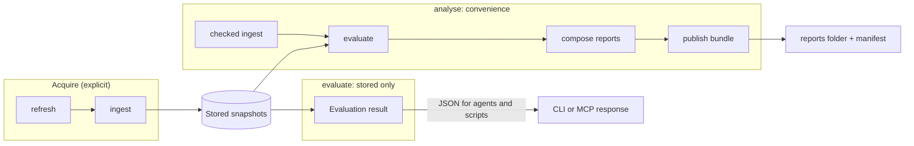
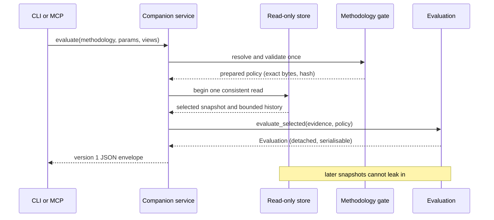
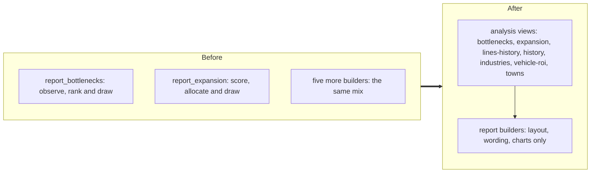

# Architecture: how responsibilities are divided

This page explains how TF3 Companion is divided, why, and how the three OpenSpec changes moved the code toward that division. The status table near the end says what is built.

Authoritative detail lives in the OpenSpec artifacts:

- [`separate-analysis-evaluation`](../openspec/changes/archive/2026-10-18-separate-analysis-evaluation/)
- [`extract-report-analyses`](../openspec/changes/archive/2026-10-18-extract-report-analyses/)
- [`retire-local-analysis-generator`](../openspec/changes/archive/2026-10-18-retire-local-analysis-generator/)

## The idea in one picture

Four responsibilities, each allowed to depend only on the ones above it.

| Layer | Answers | Owns | Must not |
|---|---|---|---|
| Evidence and facts | What do we know? | Snapshots, history, identities, the calendar clock, measured values and their caveats | Decide what is acceptable |
| Analysis and methodology | What does it mean under this way of thinking? | Algorithms, classification, tolerances, priorities, recommendations | Draw tables or write files |
| Presentation | How do we show it? | Sections, wording, formatting, charts, escaping, files | Recompute a verdict |
| Interfaces | How is it requested? | Arguments, validation of requests, serialising results | Hold business rules |

**The CLI and the MCP server are peers.** Both call the same service operations. Neither one parses a report to learn a fact.

## Facts, policy and presentation

One example travels through all three:

| Step | Statement | Layer | Changes when you switch methodology? | Changes when you switch from Markdown to a spreadsheet? |
|---|---|---|---|---|
| Fact | Line X has a rolling profit of -40,000 | Evidence | No | No |
| Judgment | It is a local feeder; this loss is within tolerance | Analysis, under a methodology | Yes | No |
| Display | It appears in the feeder table with a "within rule" marker | Presentation | No | Yes |

A methodology can change classification, markers, severities, tolerances, recommendations and which reports exist. It cannot change stored evidence, game knowledge or the data caveats. The engine is generic; the methodology is where a specific playstyle lives. The packaged `default` is an explicit baseline policy, not "no opinion".

## Three operations, three different promises

| Operation | Reads | Writes | Use it when |
|---|---|---|---|
| `ingest` / `refresh` | The game's export folder | The database | You want newer evidence |
| `evaluate` (new) | Stored evidence only | Nothing | You want the complete structured conclusion, no documents |
| `analyse` | Ingests, then evaluates | Report bundle | You want the familiar "do everything" run |
| `report KIND` | Checked ingestion, then stored evidence | Report files and manifest/latest pointer | You want a single document |

`evaluate` opens the database read-only, never discovers Steam, never imports a newer export and never creates anything. If the database does not exist it fails instead of creating one.

## What one evaluation does

The result is a versioned envelope: snapshot, save, methodology provenance, time basis, effective criteria, roles, rule outcomes, complete findings, recommendations, disabled findings and coverage (what was skipped, unsupported or not evaluable). It carries no output paths, no Markdown and no database handle. Display caps (for example the top 10 findings in a summary) apply only to presentation, never to this result.

**Unknown is not zero.** A missing value is reported as not evaluable. It never becomes 0, "false" or "healthy".

## From report builders to analysis views

Today several report modules compute diagnostics while drawing sections. `extract-report-analyses` moves that computation into seven typed views, and the reports then only present them.

- Views are requested explicitly (`tf3c evaluate --view bottlenecks`, MCP `views=[...]`). With no views, no extended history is read.
- Each view carries coverage: how many samples were eligible, read and used, and why anything is unavailable.
- Existing algorithms and statistical safeguards are preserved. Methodology policy changes how strict a judgment is, never the sample minimums.
- The company, lines, fleet, cargo, annual and decision reports get internal fact projections but no new public view names.

## Retiring the parallel generator

`data/analise/` was a personal experiment that produced the idea of methodologies. It has been removed (its seven Python sources and their caches) because the product must not depend on a checkout's `data/` folder. Nothing replaces it: no wrapper, relocated copy or private generator.

| Fate | Examples |
|---|---|
| Already covered by the product | Feeder, intercity and freight tolerances; load notices; town balance |
| Kept as a generic capability | Persistent-load trends, evolution by role (through views) |
| Discarded deliberately | Producer-to-line-to-consumer chains inferred from names; replacement payback with unverified units; personal page layout and name codes |
| Never touched | Player snapshots, databases, preferences, previously generated reports |

The packaged `local-feeder-intercity-trunk` stays as an optional, self-contained example with unchanged bytes. Its aircraft screening (watch from 3.0, problem from 3.5 aircraft per terminal) is policy screening, not capacity or congestion. The old generator's watch-only rule is a documented historical difference, not a parity target.

Acceptance is a real installed-wheel run outside the checkout, with synthetic evidence and name-free methodologies, exercising service, CLI and MCP (`tests/test_installed_analysis.py`). The wheel is built and installed offline from uv's local cache; if that cache lacks the build backend or dependency wheels, the test fails naming the prerequisite instead of reaching a package index.

## Rules of the road

1. A new calculation goes in the analysis layer and returns structured data first.
2. A new report reads that data. If a report needs a number, ask for it from the analysis layer; do not compute it in the builder.
3. CLI and MCP add no logic. If both need it, it belongs in the service.
4. Missing evidence stays unknown with a reason, in every layer.
5. Runtime inputs (database, imported methodologies, preferences) are configuration under the data directory. Nothing in the product may read the checkout's `data/` folder.
6. Language: everything written to disk is English. See [AGENTS.md](../AGENTS.md).

## Status

| Change | Purpose | State |
|---|---|---|
| Activation gate, report policies, calendar time, user default | Prerequisites | Archived, in the codebase |
| `separate-analysis-evaluation` | `evaluate`, read-only access, composite cutover | Archived, specs synced |
| `extract-report-analyses` | Seven typed views, thin report builders | Archived, specs synced |
| `retire-local-analysis-generator` | Remove `data/analise`, installed-package acceptance | Archived, specs in the main specs |

All project work is tracked in [TODO.md](../TODO.md): one integration owner, ordered priorities, explicit blockers and verified Done cards. Follow [the delivery lifecycle](../CONTRIBUTING.md#work-tracking-and-delivery). Archived source delivery does not close later bugs or live-game acceptance gates.
